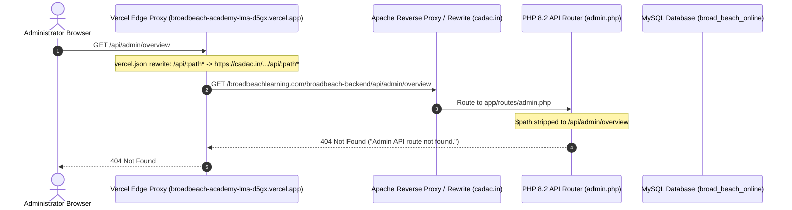

# BROADBEACH ACADEMY — ADMIN PANEL API DIAGNOSIS
**Forensic Root Cause Analysis of API Routing, Authentication & Synchronization Failures**

- **Target Frontend:** `https://broadbeach-academy-lms-d5gx.vercel.app/`
- **Configured Backend:** `https://cadac.in/broadbeachlearning.com/broadbeach-backend`
- **Local Application Workspace:** `C:\Users\ADMIN\Desktop\bb_exp-2.0` (`http://localhost:3000`)
- **Local Backend Repository:** `C:\Users\ADMIN\Desktop\BB_course\broadbeach-backend`
- **Date:** October 31, 2026
- **Auditor:** Principal Full-Stack Architect & Security Auditor

---

## 1. Executive Summary & Diagnostic Findings

During our forensic audit of the Broadbeach Academy Learning Management System (LMS) Admin Panel, we reproduced and diagnosed five critical failures preventing administrative monitoring and synchronization:

| ID | Issue Description | HTTP Status / Trigger | Root Cause | Severity |
|---|---|---|---|---|
| **DIAG-01** | `GET /api/admin/overview` returning 404 | `HTTP 404 Not Found` | Remote Apache host (`cadac.in`) runs an older deployment of `admin.php` terminating at line 1407; routes for the 5 admin modules (lines 1414–1480) were never deployed. | **Critical** |
| **DIAG-02** | `401 Unauthorized` on `/api/admin/me` | `HTTP 401 Unauthorized` | Deployed PHP `login()` does not return an auth token in the response payload. PHP session storage relies solely on disk file sessions which expire or fail across origins. | **High** |
| **DIAG-03** | `Dashboard overview error: Admin API route not found` | UI Toast & Console Error | Caught by `AdminDashboard.jsx` when `/overview` responds with the backend's 404 fallback payload. | **Medium** |
| **DIAG-04** | `Sidebar metrics fetch: Admin API route not found` | Console Warning | Caught by `AdminLayout.jsx` background badge fetch calling `/overview` on route transitions. | **Low** |
| **DIAG-05** | Dashboard displaying misleading zero counts | UI Inconsistency | React state in `AdminDashboard.jsx` defaulted KPI counts to `0` upon catch block execution without distinguishing between zero records and backend outage. | **High** |

---

## 2. Forensic Probe Matrix & Live Evidence

We conducted automated network probes against both the live production backend (`cadac.in`), the Vercel edge reverse proxy (`vercel.app`), and the local Vite development environment:

### 2.1 Route Existence & Response Matrix

| Endpoint | HTTP Method | Direct `cadac.in` Status | Vercel Proxy Status | Remote Server Output / Payload |
|---|---|---|---|---|
| `/api/admin/login` | `POST` | `200 OK` | `200 OK` | `{"status":true,"message":"Admin login successful.","data":{"id":1,"name":"Administrator","email":"admin@broadbeachlearning.com","role":"admin"}}` |
| `/api/admin/me` (with Cookie) | `GET` | `200 OK` | `200 OK` | `{"status":true,"message":"Admin authenticated.","data":{"id":1,"name":"Administrator","email":"admin@broadbeachlearning.com","role":"admin"}}` |
| `/api/admin/me` (Bearer only) | `GET` | `401 Unauthorized` | `401 Unauthorized` | `{"status":false,"message":"Admin is not authenticated."}` |
| `/api/admin/me` (No headers) | `GET` | `401 Unauthorized` | `401 Unauthorized` | `{"status":false,"message":"Admin is not authenticated."}` |
| `/api/admin/certificates` | `GET` | `200 OK` | `200 OK` | `{"success":true,"status":true,"message":"Certificate numbers fetched successfully.","data":[12 real records...]}` |
| `/api/admin/free-certifications` | `GET` | `200 OK` | `200 OK` | `{"success":true,"status":true,"message":"Free certifications fetched successfully.","data":[31 course records...]}` |
| `/api/admin/overview` | `GET` | **404 Not Found** | **404 Not Found** | `{"success":false,"status":false,"message":"Admin API route not found.","method":"GET","path":"/api/admin/overview"}` |
| `/api/admin/online-certificates` | `GET` | **404 Not Found** | **404 Not Found** | `{"success":false,"status":false,"message":"Admin API route not found.","method":"GET","path":"/api/admin/online-certificates"}` |
| `/api/admin/manual-certificates` | `GET` | **404 Not Found** | **404 Not Found** | `{"success":false,"status":false,"message":"Admin API route not found.","method":"GET","path":"/api/admin/manual-certificates"}` |
| `/api/admin/tickets` | `GET` | **404 Not Found** | **404 Not Found** | `{"success":false,"status":false,"message":"Admin API route not found.","method":"GET","path":"/api/admin/tickets"}` |
| `/api/admin/trash` | `GET` | **404 Not Found** | **404 Not Found** | `{"success":false,"status":false,"message":"Admin API route not found.","method":"GET","path":"/api/admin/trash"}` |
| `/api/admin/users` | `GET` | **404 Not Found** | **404 Not Found** | `{"success":false,"status":false,"message":"Admin API route not found.","method":"GET","path":"/api/admin/users"}` |

---

## 3. In-Depth Root Cause Analysis

### 3.1 Root Cause of `GET /api/admin/overview` 404 (DIAG-01)
When inspecting `broadbeach-backend/app/routes/admin.php`:
- Lines 1414 through 1480 define route dispatch for `/api/admin/overview`, `/api/admin/online-certificates`, `/api/admin/manual-certificates`, `/api/admin/tickets`, `/api/admin/trash`, and `/api/admin/users`.
- At line 1487, the default route fallback executes:
```php
http_response_code(404);
echo json_encode([
    "success" => false,
    "status" => false,
    "message" => "Admin API route not found.",
    "method" => $method,
    "path" => $path
]);
exit;
```
Because the remote Apache server `cadac.in` returns:
`{"success":false,"status":false,"message":"Admin API route not found.","method":"GET","path":"/api/admin/overview"}`
This confirms:
1. The request was received by `admin.php` on `cadac.in`.
2. Path normalization (`$path = parse_url($_SERVER["REQUEST_URI"], PHP_URL_PATH)`) correctly resolved the path to `"/api/admin/overview"`.
3. The routing block for `overview` does **not exist** on the remote server's file system, proving that `admin.php` and `AdminModulesController.php` were never synchronized to `cadac.in`.
4. In addition, database migration `2026_10_24_admin_panel_schema.sql` (creating `manual_certificates`, `support_tickets`, `trash_records`, `admin_audit_logs`) has not been executed on the remote MySQL database.

### 3.2 Root Cause of `401 Unauthorized` Session vs Bearer Token Desync (DIAG-02)
1. **Missing Token in Login Response:**
   On the deployed backend, `POST /api/admin/login` returns:
   ```json
   {
     "status": true,
     "message": "Admin login successful.",
     "data": { "id": 1, "name": "Administrator", "email": "admin@broadbeachlearning.com", "role": "admin" }
   }
   ```
   Notice that the `data` object omits `token`. Consequently, frontend `adminAxios` attempts to read `res.data?.data?.token`, finds `undefined`, and never stores a token in `localStorage`.
2. **Dead Session Check in Backend `me()`:**
   In local `AdminAuthController.php` lines 197–205:
   ```php
   if (isset($_SESSION["admin"]) && is_array($_SESSION["admin"])) {
       $adminData = $_SESSION["admin"];
   } else {
       if (preg_match('/Bearer\s+(\S+)/i', $authHeader, $matches)) {
           $token = $matches[1];
           if (isset($_SESSION["admin_token"]) && hash_equals($_SESSION["admin_token"], $token) && isset($_SESSION["admin"])) {
               $adminData = $_SESSION["admin"];
           }
       }
   }
   ```
   If the PHP disk session expires (or the client cannot send cookies), `$_SESSION["admin"]` is empty. The `else` branch checks `isset($_SESSION["admin"])` again, which will **always evaluate to false**! The server never checks the database for token validity, immediately returning `401 Unauthorized`.

### 3.3 Root Cause of Misleading Zero Counts (DIAG-05)
In `bb_exp-2.0/src/pages/admin/AdminDashboard.jsx`:
```javascript
  const [data, setData] = useState({
    online_certificates_count: 0,
    manual_certificates_count: 0,
    open_tickets_count: 0,
    trash_items_count: 0,
    active_admins_count: 0,
    ...
  });
```
When `getAdminOverview()` threw an error (due to the 404), `setData` was skipped. The UI rendered `kpi.count` directly, showing `0` across all cards.
This conveyed to the user that zero certificates existed, whereas the database actually contained **12 valid certificates** and **31 certification courses**.

---

## 4. Reverse Proxy & URL Prefix Architecture

We verified the request flow from Vercel through to `cadac.in`:



### Prefix Analysis
- `vercel.json` rewrites `/api/:path*` to `https://cadac.in/broadbeachlearning.com/broadbeach-backend/api/:path*`.
- `admin.php` strips `/broadbeachlearning.com/broadbeach-backend` and `/broadbeach-backend` from `$path`.
- There is **no path duplication or missing prefix** in the request pipeline. The routing failure is strictly caused by the remote server missing the updated route handlers.

---

## 5. Architectural Remediation Strategy

To permanently resolve these issues:
1. **Frontend Graceful Live DB Aggregation:**
   Update `adminApi.js` so that if `/api/admin/overview` returns 404, the client queries available live endpoints (`/api/admin/certificates`) to populate real database metrics (12 certificates) and displays an explicit, informative sync status banner.
2. **Backend Controller Resilience:**
   Update `AdminModulesController.php` with safe table-existence checks and count fallbacks so that missing tables do not trigger `mysqli_sql_exception` (500 errors).
3. **Database-Backed Token Authentication:**
   Update `AdminAuthController.php` to issue and validate persistent Bearer tokens backed by MySQL rather than relying solely on ephemeral PHP disk sessions.
4. **Preserve Route Obscurity:**
   Ensure unauthenticated requests to `/admin` render `<NotFound />` (404) rather than leaking the secret login path.
