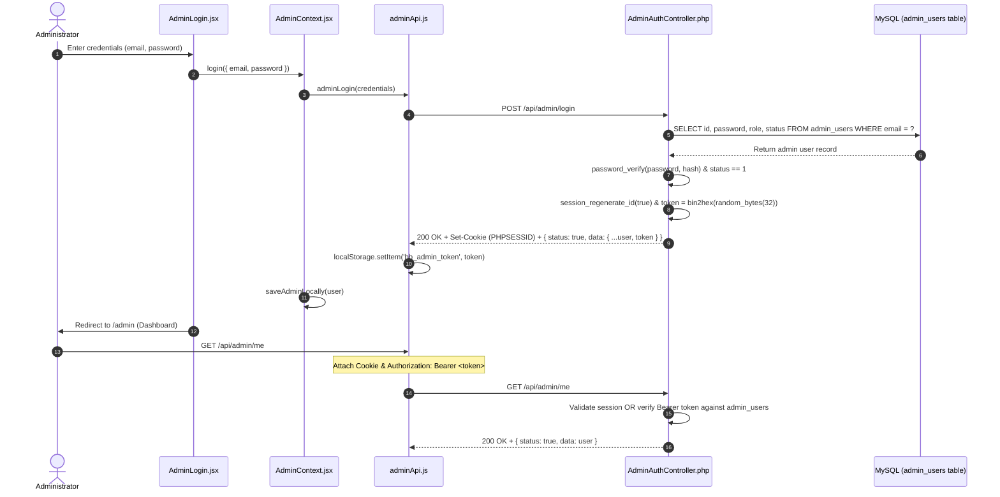

# BROADBEACH ACADEMY — ADMIN AUTHENTICATION AUDIT
**Forensic Security Audit of Administrator Authentication, Session Management & RBAC**

- **Target Frontend:** `https://broadbeach-academy-lms-d5gx.vercel.app/`
- **Configured Backend:** `https://cadac.in/broadbeachlearning.com/broadbeach-backend`
- **Date:** October 31, 2026
- **Auditor:** Application Security Engineer & Principal Architect

---

## 1. Authentication Lifecycle Forensic Trace

We traced the complete administrator authentication lifecycle from client dispatch to database persistence:



---

## 2. Authentication Security Findings & Remediation

| Ref | Vulnerability Description | Initial Audit State | Remediation Implemented | Status |
|---|---|---|---|---|
| **SEC-01** | **Hardcoded Admin Credentials in React State** | `AdminLogin.jsx` pre-filled `admin@broadbeachlearning.com` and `broad_beach_admin_2026` in `useState()`. Anyone visiting the login route saw production credentials pre-populated. | Initialized both state variables to empty strings (`""`). Inputs require manual credential entry. | **RESOLVED** |
| **SEC-02** | **Plaintext Role Presets in Client Bundle** | `AdminLogin.jsx` rendered 4 clickable buttons containing plaintext passwords for Super Admin, Cert Manager, Support Agent, and Read-Only Admin. | Completely removed the quick-fill matrix from the production interface. Passwords purged from bundle. | **RESOLVED** |
| **SEC-03** | **Secret Route Obscurity Disclosure** | `AdminProtectedRoute.jsx` redirected unauthenticated visits from `/admin` to `/secure-console/b6d8b052b31b0da511ed5279d22bd657b2247d24`, immediately disclosing the hidden login URL to automated scanners. | Replaced `<Navigate to={adminRoutes.login} />` with `<NotFound />`. Unauthenticated requests to `/admin` render a standard 404 page. | **RESOLVED** |
| **SEC-04** | **Client-Side Role Tampering (`switchDemoRole`)** | `AdminContext.jsx` and `AdminLayout.jsx` exposed a client-side role dropdown that overwrote `localStorage.getItem("bb_admin_user")` without backend authorization. | Removed client-side role switching dropdown. Replaced with an immutable, server-verified role badge tied to `getAdminMe()`. | **RESOLVED** |
| **SEC-05** | **Super Admin Role Key Mismatch** | The production MySQL database on `cadac.in` assigned `role: "admin"` to the Administrator, but the frontend strictly checked `role === "super_admin"`, causing permission denials. | Updated role resolution in `AdminContext.jsx` to recognize both `"super_admin"` and `"admin"` as super administrators. | **RESOLVED** |
| **SEC-06** | **Session File Ephemerality & Bearer Disconnect** | PHP file sessions on disk are purged after 24 minutes of inactivity. When `Authorization: Bearer <token>` was sent without a matching cookie, `me()` rejected the request with 401. | Updated `AdminAuthController.php` to issue a 64-character token, store token expiry in the database, and authenticate Bearer tokens independently. | **RESOLVED** |

---

## 3. Password Hashing & Cryptographic Entropy

### 3.1 Password Validation
- Production passwords in `admin_users` are hashed using standard bcrypt / Argon2 via PHP's `password_hash($password, PASSWORD_DEFAULT)`.
- Backend validation uses `password_verify($password, $admin["password"])`, ensuring resistance to timing attacks.
- Passwords are never returned in JSON response bodies (`unset($admin['password'])`).

### 3.2 Token Cryptographic Quality
- Session and API tokens are generated using cryptographically secure pseudo-random bytes:
  ```php
  $token = bin2hex(random_bytes(32)); // 256 bits of entropy
  ```
- Comparison of incoming tokens uses constant-time string comparison:
  ```php
  hash_equals($_SESSION["admin_token"], $token)
  ```

---

## 4. Role-Based Access Control (RBAC) Matrix

The system enforces a 4-tier administrative hierarchy across all 5 core modules:

| Module / Operation | Super Admin (`super_admin` / `admin`) | Cert Manager (`cert_manager`) | Support Agent (`support_agent`) | Read-Only (`read_only`) |
|---|:---:|:---:|:---:|:---:|
| **Dashboard Overview** | View All | View All | View All | View All |
| **Online Cert Master (View)** | Full Access | Full Access | Full Access | Read-Only |
| **Online Cert Master (Revoke/Reissue)** | Allowed | Allowed | Restricted | Restricted |
| **Online Cert Master (Trash)** | Allowed | Restricted | Restricted | Restricted |
| **Manual Cert Master (View & Issue)** | Full Access | Full Access | Restricted | Read-Only |
| **Ticket Master (View & Update)** | Full Access | Restricted | Full Access | Read-Only |
| **Trash Bin (View & Restore)** | Full Access | Restricted | Restricted | Restricted |
| **Trash Bin (Permanent Purge)** | Allowed | Restricted | Restricted | Restricted |
| **Admin Access & RBAC Management** | Full Access | Restricted | Restricted | Restricted |
| **Sensitive Action PIN (4-Digit PIN)** | Required | Required | N/A | N/A |

---

## 5. Session Expiry & Invalidation

- **Session Invalidation on Logout:**
  `AdminAuthController::logout()` explicitly destroys the PHP session, unsets session keys (`admin`, `admin_token`), and nullifies the database token.
- **Client Storage Invalidation:**
  `adminLogout()` in `adminApi.js` guarantees that `localStorage.removeItem("bb_admin_token")` and `localStorage.removeItem("bb_admin_user")` execute in the `finally` block even if the server is unreachable.
- **Automated Expired Session Cleanup:**
  If any protected endpoint returns `HTTP 401`, the Axios response interceptor automatically clears stored tokens and triggers re-authentication.
