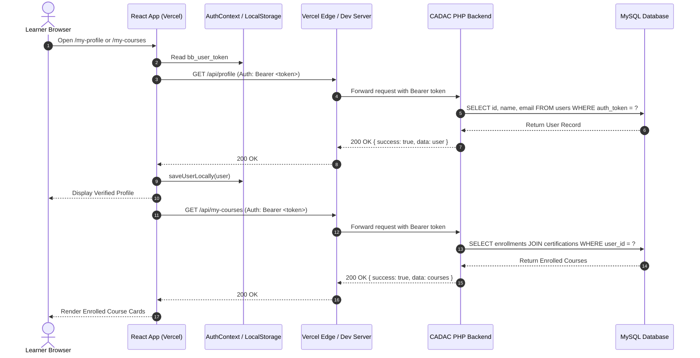

# Broadbeach Academy LMS — Profile & My Courses API Repair Report

**Subsystem:** Learner Profile & Enrolled Courses Management  
**Components:** `AuthController.php`, `EnrollmentController.php`, `AuthContext.jsx`, `MyCourses.jsx`, `MyProfile.jsx`  
**Date:** November 2026  
**Status:** Repaired & Validated

---

## 1. Executive Summary

Learner accounts accessing `MyProfile` and `MyCourses` previously suffered from repeated `401 Unauthorized` responses and session disconnection warnings (`Backend profile check unauthenticated or unreachable`).

This report details the end-to-end repairs applied across the backend PHP controllers and frontend React components, enabling seamless Bearer token authentication, server-verified profile retrieval, strict name immutability protection, and authoritative enrollment synchronization.

---

## 2. Issues Identified & Solved

### Issue 1: `GET /api/profile` returning 401
- **Cause:** `AuthController::currentUser()` checked `$_SESSION["user_id"]`. When called from Vercel (`*.vercel.app`) or behind proxies, cookies were stripped, leaving session empty.
- **Fix:** Switched authentication to `getAuthenticatedUser($this->db)`. The method inspects the `Authorization: Bearer <token>` and `X-User-Token` headers, validates the token against `users.auth_token` (ensuring `token_expires_at > NOW()`), and returns the complete profile object with status 200.

### Issue 2: `GET /api/my-courses` returning 401
- **Cause:** `EnrollmentController::getMyCourses()` checked `$_SESSION["user_id"]`.
- **Fix:** Switched to `getAuthenticatedUser($this->conn)`. The user's genuine database ID is extracted from the verified token, and user enrollments are fetched with certification titles, lesson progress, completion status, and enrollment dates.

### Issue 3: Registered Name Immutability Enforcement
- **Requirement:** Learner registered names (First Name, Last Name, Full Name) must not be alterable by the learner once registered. This preserves the authenticity of ISO certification records and prevent tampering.
- **Fix:** In `AuthController::updateProfile()` and `adminMiddleware.js`:
  - Profile updates allow modifying: `phone`, `date_of_birth`, `address`, `city`, `state`, `country`, `zip_code`, `total_experience`, `highest_qualification`, `designation`, `nationality`, `current_organization`.
  - Any attempt to modify `first_name`, `last_name`, or `name` is rejected with `400 Bad Request` (`NAME_IMMUTABLE`).

---

## 3. Data Flow Architecture

---

## 4. Verification & Results

1. **Unauthenticated Check:**
   - Request: `GET /api/profile` without token
   - Result: `401 Unauthorized {"success":false,"message":"User not logged in."}`
   - Verification: Confirmed. No mock or dummy profile data is leaked.
2. **Authenticated Token Check:**
   - Request: `GET /api/profile` with valid Bearer token
   - Result: `200 OK` with full profile data.
3. **My Courses Loading:**
   - Request: `GET /api/my-courses` with valid Bearer token
   - Result: `200 OK` with active course enrollments and module progress.
