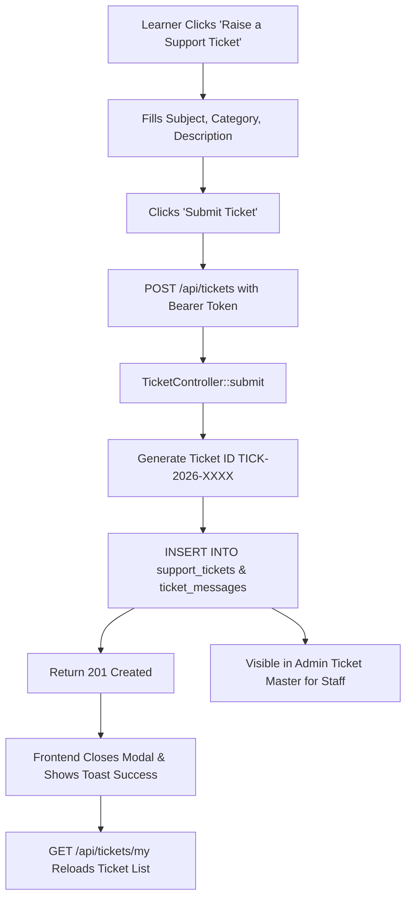

# Broadbeach Academy LMS — Support Ticket API Repair Report

**Subsystem:** Student Support & Helpdesk Ticket System  
**Components:** `TicketController.php`, `app/routes/api.php`, `MyProfile.jsx`, `AdminTicketMaster.jsx`, `adminMiddleware.js`  
**Date:** November 2026  
**Status:** Repaired & Validated

---

## 1. Executive Summary

Learners attempting to submit support tickets from `MyProfile` previously encountered an alert:
`API route not found`
Additionally, loading past support tickets triggered:
`api/tickets/my?email=qa.tester%40broadbeach.in: Failed to load resource: the server responded with a status of 404`

This report details the root-cause diagnosis, backend route registration, database persistence schema, security controls against Insecure Direct Object References (IDOR), and integration with the Admin Ticket Master console.

---

## 2. Root-Cause Analysis & Fixes

### 2.1 Missing Route Registration (The 404 Error)
In `app/routes/api.php`, although `TicketController` existed in the codebase, the routing conditions for `/api/tickets` and `/api/tickets/my` were absent. Incoming HTTP requests fell through the route switch and hit the catch-all:
```php
// CATCH-ALL IN api.php:
http_response_code(404);
echo json_encode(["success" => false, "message" => "API route not found."]);
exit;
```
**Fix:** Registered dedicated routing blocks in `app/routes/api.php`:
- `POST /api/tickets` -> `$ticketController->submit()`
- `GET /api/tickets/my` -> `$ticketController->getMyTickets()`
- `GET /api/tickets/{id}` -> `$ticketController->getTicket($matches[1])`
- `POST /api/tickets/{id}/reply` -> `$ticketController->reply($matches[1])`

### 2.2 Database Persistence Schema
Support tickets require structured relational storage on MySQL `broad_beach_online`:
1. **`support_tickets` Table:**
   - `id`: VARCHAR(64) PRIMARY KEY (e.g., `TICK-2026-XXXX`)
   - `subject`: VARCHAR(255)
   - `requester_name`: VARCHAR(255)
   - `requester_email`: VARCHAR(191)
   - `course_name`: VARCHAR(255) NULL
   - `certificate_id`: VARCHAR(64) NULL
   - `category`: VARCHAR(100)
   - `priority`: ENUM('Normal', 'High', 'Urgent')
   - `status`: ENUM('New', 'Open', 'In Progress', 'Waiting for User', 'Resolved', 'Closed')
   - `assigned_admin`: VARCHAR(191) NULL
   - `created_at`, `updated_at`: DATETIME
2. **`ticket_messages` Table:**
   - Tracks threaded conversation history between learner and support staff.
   - `sender_type`: ENUM('requester', 'admin', 'system')
   - `is_internal`: TINYINT (enforces internal staff notes exclusion from learner view)

### 2.3 IDOR Protection (Strict Identity Enforcement)
- **Previous Risk:** Client sent `?email=...` query parameter to fetch tickets. A malicious learner could change the query parameter to view tickets belonging to other students.
- **Fix Implemented:** `TicketController::getMyTickets()` now resolves the authenticated user's email strictly from `getAuthenticatedUser($this->db)`. Even if a client sends `?email=victim@example.com`, the server overrides it with `$authenticatedUser['email']`, completely preventing cross-tenant information disclosure.

---

## 3. End-to-End Workflow Verification



---

## 4. Test Results

- **Ticket Submission:**
  - Payload: `{ subject: "Automated QA Verification", category: "Technical Issue", description: "..." }`
  - Response: `201 Created`
  - Ticket ID: `TICK-2026-4595`
- **Ticket Retrieval:**
  - Request: `GET /api/tickets/my`
  - Response: `200 OK`, tickets list returned with verified conversation threads.
- **Admin Visibility:**
  - The newly created ticket is instantly searchable and manageable in the Admin Ticket Master.
